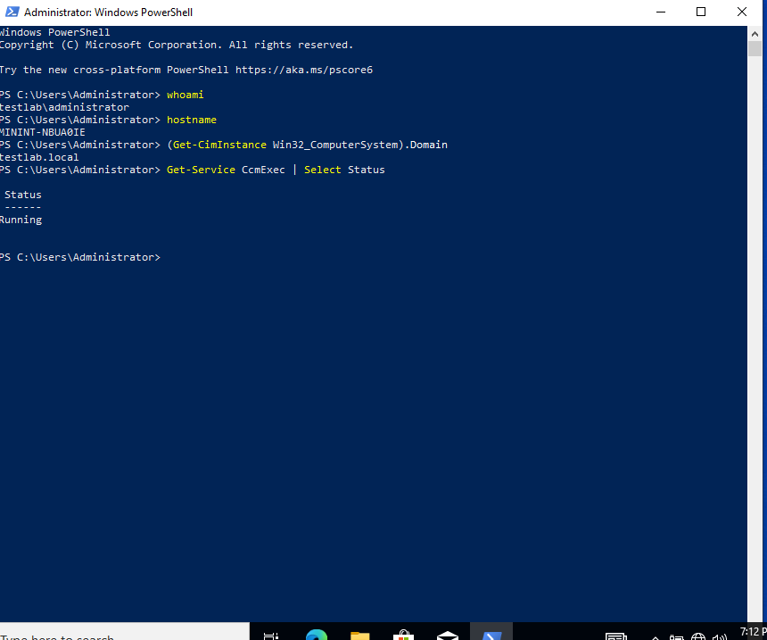
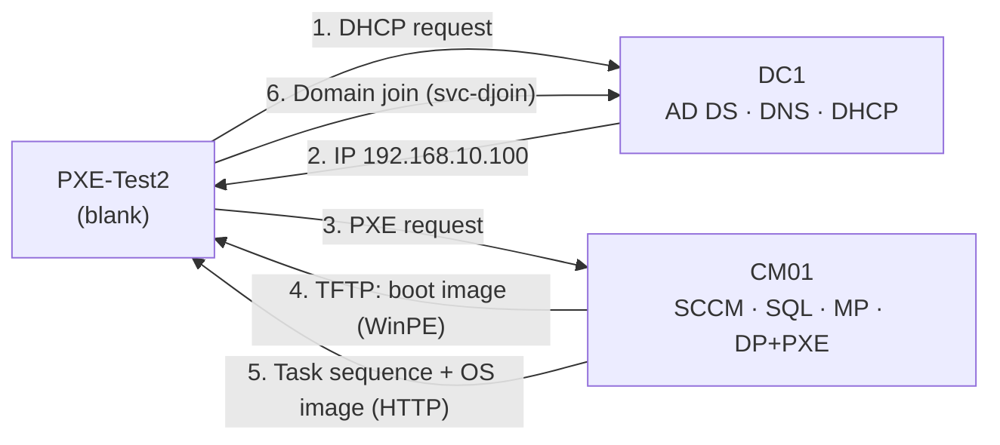

# Network OS Deployment with SCCM: A Lab Journal

**Goal:** A blank computer boots from the network, installs Windows by itself, joins the domain and comes up with the SCCM client installed.

**Scope:** Bare-metal deployment of the stock Windows 10 Pro `install.wim`. No custom (golden) image, no application deployment or software updates.

**Result:** It worked, after a schema error, SQL connection problems, an expired DC license, a full disk, a broken install and random TFTP drops. This repo is the record of that path: what broke, how I found the root cause, and how I fixed it.

## Key terms

| Term | Meaning |
| --- | --- |
| **SCCM / ConfigMgr** | Microsoft Configuration Manager. Manages company computers: software, updates, inventory and OS installs |
| **OSD** | Operating System Deployment. Installing Windows on machines from SCCM |
| **Site (TL1)** | One SCCM installation, identified by a 3-character site code |
| **Management Point (MP)** | Where clients ask "what should I do?" Gives policies and instructions |
| **Distribution Point (DP)** | Where content (images, packages) is stored and downloaded from |
| **PXE** | Booting a computer from the network instead of a disk |
| **WinPE** | A small Windows that runs from RAM during the install |
| **Boot image** | The WinPE package SCCM sends over PXE |
| **OS image (`install.wim`)** | The real Windows that gets written to the disk |
| **Task sequence** | The ordered list of install steps (partition disk, apply Windows, join domain, install client) |
| **Boundary group** | Tells a client, by its IP, which site and DP to use |
| **Unknown computer** | A machine SCCM has no record of, like a brand-new PC |

## How a network deployment works

What happens when the blank machine boots (screens from [chapter 6](docs/06-first-attempt.md) and [chapter 7](docs/07-second-attempt-success.md)):

1. **DHCP:** The network card asks for an IP. DC1 gives `192.168.10.100`.
2. **PXE answer:** CM01 hears the same broadcast and answers as the boot server.
3. **wdsnbp.com:** Downloaded over TFTP. Reports the CPU type (x64) and asks SCCM if there is a deployment for this machine.
4. **pxeboot.com:** The deployment is *Available*, so it shows "Press F12".
5. **Boot image:** Boot Manager downloads `TL100002.WIM` over TFTP into RAM. *(0xc0000001 happened here, chapter 7.)*
6. **WinPE:** Starts, asks for the PXE password, then asks the **MP** which task sequences exist.
7. **Task sequence:** Partitions the disk and writes the OS image, downloaded from the **DP** over HTTP. *(0x80070070 happened here, chapter 6.)*
8. **Windows + domain + client:** Windows setup finishes, joins `testlab.local` with `svc-djoin`, installs the SCCM client (`CcmExec`).

Chapters 1–5 build everything this flow needs: AD and SQL (1–2), the SCCM site (3–4), and the DHCP, PXE, images and task sequence (5).

## Lab environment

VirtualBox on a laptop with 16 GB RAM. All VMs on an internal network (`intnet`, 192.168.10.0/24).

| VM | IP | Role | OS |
| --- | --- | --- | --- |
| DC1 | 192.168.10.10 | AD DS, DNS, DHCP | Windows Server 2022 |
| CM01 | 192.168.10.30 | SCCM 2509 site TL1, SQL Server 2022, MP, DP + PXE | Windows Server 2022 |
| PXE-Test2 | 192.168.10.100 (DHCP) | Blank client (BIOS, 60 GB, 2 GB RAM) | Windows 10 Pro after deployment |

## How to read this repo

Read the chapters in order; each one starts where the previous one ended. Every chapter has the same shape:

**Where we are** → what I did → 🔴 what broke → 🔍 root cause → fix → ✅ check → **Lesson** → **Next**

## Chapters

| # | Chapter | What happened |
| --- | --- | --- |
| 1 | [Preparation and Active Directory](docs/01-preparation-and-ad.md) | Schema extension failed with 8224. Cause: DNS on the NAT adapter |
| 2 | [Prerequisites and SQL Server](docs/02-prerequisites-and-sql.md) | IIS, .NET 3.5, ADK, WinPE, SQL Server 2022. One test here hid the next problem |
| 3 | [SCCM installation](docs/03-sccm-installation.md) | Prerequisite check failed. Root cause: TCP/IP disabled in SQL. Then "SQL RMO" error caused by an old VC++ |
| 4 | [Morning surprise: DC license](docs/04-dc-license.md) | Hierarchy Manager critical, nothing published to AD. The DC's evaluation license had expired |
| 5 | [OSD configuration](docs/05-osd-configuration.md) | DHCP, boundaries, PXE, boot image, service account, OS image, task sequence |
| 6 | [First attempt](docs/06-first-attempt.md) | PXE worked, disk was full (0x80070070). Second run hung, VM was lost |
| 7 | [Second attempt and success](docs/07-second-attempt-success.md) | TFTP kept failing (0xc0000001). Root cause: Hyper-V/VBS on the host |

## Top 3 lessons

1. **Many failures, one cause** ([ch. 3](docs/03-sccm-installation.md)): Collation, sysadmin and dedicated-instance checks all failed, but all three were correct. Setup could not reach SQL over TCP. My `localhost` test used shared memory, so it looked fine.
2. **The error and the cause were on different machines** ([ch. 4](docs/04-dc-license.md)): An SCCM error was really an expired license on the DC.
3. **When a fix makes it worse, look at another layer** ([ch. 7](docs/07-second-attempt-success.md)): Smaller TFTP blocks made it worse. The real problem was VirtualBox running on top of Hyper-V.

## Skills used

- Active Directory: schema extension, ADSI Edit, container permissions, password policy, service accounts
- DHCP, DNS and the PXE boot flow (DHCP → TFTP → WinPE)
- SQL Server setup for SCCM (collation, memory, TCP/IP, service account)
- Configuration Manager: site install, boundaries, DP/PXE, boot and OS images, task sequences, deployments
- Log-based troubleshooting: `ExtADSch.log`, `ConfigMgrSetup.log`, `hman.log`, `SMSPXE.log`
- PowerShell for checks and automation

## Security notes (lab vs production)

| Lab shortcut | Risk | Production |
| --- | --- | --- |
| SQL service runs as Local System | Full server access if compromised | Low-privilege domain account or gMSA |
| `svc-djoin` password stored in the task sequence | Credential exposure | Rights only on the target OU, no interactive logon |
| Fixed local admin password | Same password everywhere | Windows LAPS |
| PXE + unknown computer support on | Anyone on the network can start a deployment | Enable only when needed, strong PXE password |
| Hyper-V / VBS turned off on host | Credential Guard, HVCI disabled | Turn back on: `bcdedit /set hypervisorlaunchtype auto` |
| DC evaluation license extended with `slmgr /rearm` | Temporary fix | Licensed server |

Passwords are hidden in all screenshots and are not in this repo.

## Next steps

- Set the computer name with `OSDComputerName` and choose a target OU
- Add applications and driver packages to the task sequence
- Test PXE with UEFI
- Build & Capture a golden (reference) image with updates and base apps, then deploy it the same way

## References (Microsoft Learn)

- [Site and site system prerequisites](https://learn.microsoft.com/en-us/intune/configmgr/core/plan-design/configs/site-and-site-system-prerequisites)
- [Extend the Active Directory schema](https://learn.microsoft.com/en-us/intune/configmgr/core/plan-design/network/extend-the-active-directory-schema)
- [Support for SQL Server versions](https://learn.microsoft.com/en-us/intune/configmgr/core/plan-design/configs/support-for-sql-server-versions)
- [Prerequisite checker](https://learn.microsoft.com/en-us/intune/configmgr/core/servers/deploy/install/prerequisite-checker)
- [Use PXE to deploy Windows over the network](https://learn.microsoft.com/en-us/intune/configmgr/osd/deploy-use/use-pxe-to-deploy-windows-over-the-network)
- [Prepare site system roles for OS deployments](https://learn.microsoft.com/en-us/intune/configmgr/osd/get-started/prepare-site-system-roles-for-operating-system-deployments)
- [Prepare for unknown computer deployments](https://learn.microsoft.com/en-us/intune/configmgr/osd/get-started/prepare-for-unknown-computer-deployments)
- [Manage boot images](https://learn.microsoft.com/en-us/intune/configmgr/osd/get-started/manage-boot-images)
- [Troubleshoot PXE boot issues](https://learn.microsoft.com/en-us/troubleshoot/mem/configmgr/os-deployment/troubleshoot-pxe-boot-issues)
- [Log files](https://learn.microsoft.com/en-us/intune/configmgr/core/plan-design/hierarchy/log-files)

---
Author: Cemal
