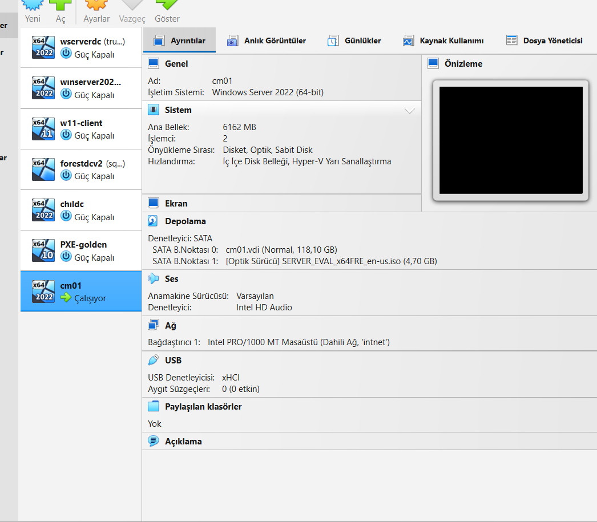
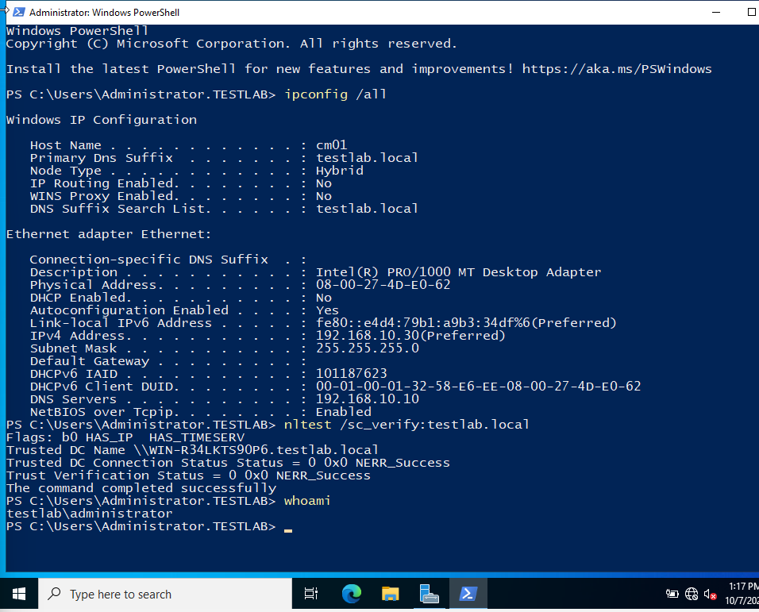
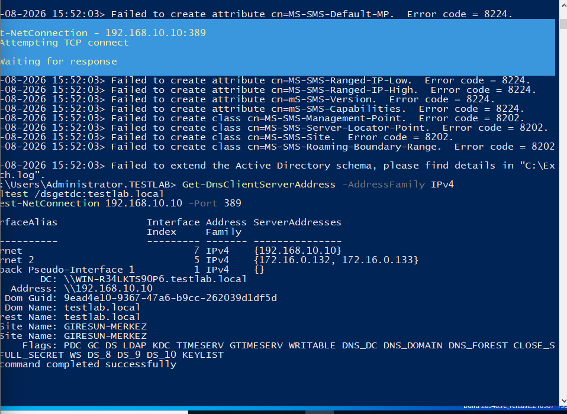
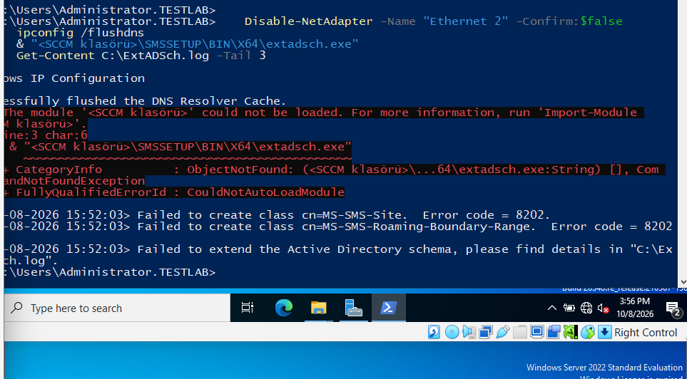
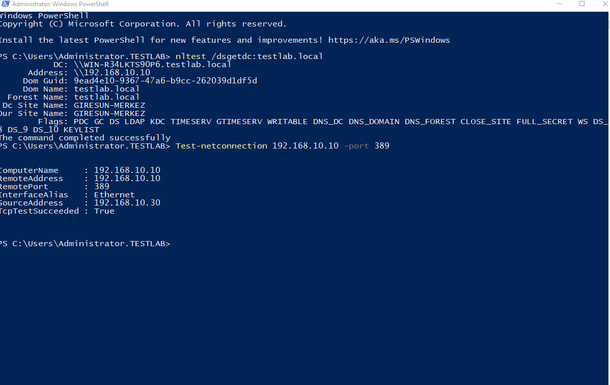
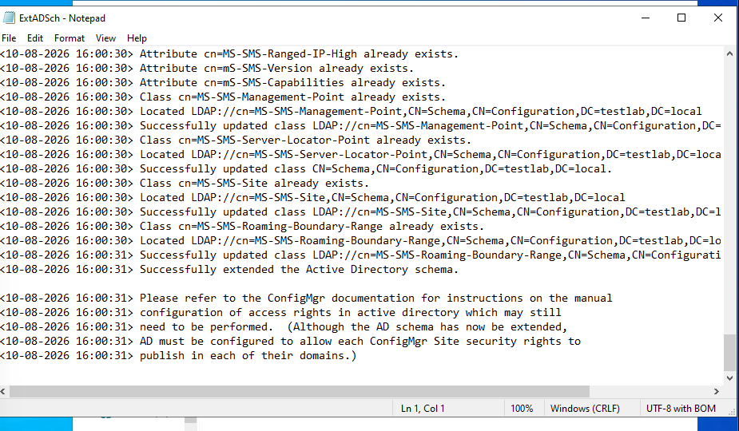
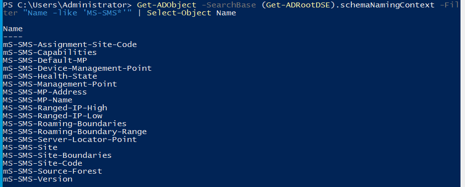
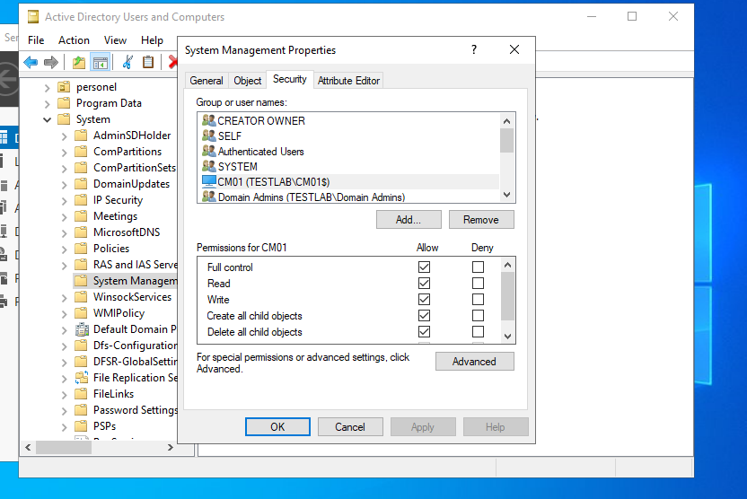

# Chapter 1: Preparation and Active Directory

[README](../README.md) · [Next: Prerequisites and SQL →](02-prerequisites-and-sql.md)

**Where we are:** Nothing installed yet. DC1 (AD, DNS, DHCP) is running.  
**In this chapter:** Build CM01, join it to the domain and prepare AD for SCCM. SCCM publishes its site and Management Point to AD so clients can find it.

---

## CM01 and the domain

Windows Server 2022, 6 GB RAM, on `intnet`. Static IP 192.168.10.30, DNS pointing to DC1 (192.168.10.10).





I also added a second NAT adapter (`Ethernet 2`) for internet downloads. This caused the next problem.

## 🔴 Schema extension failed: 8224

`extadsch.exe` returned `8224` for every `mS-SMS-*` attribute and `8202` for classes.



**Root cause:** The NAT adapter had its own DNS servers (`172.16.0.132`, `172.16.0.133`). With two adapters, Windows sometimes sent `testlab.local` queries to the NAT DNS, which does not know the domain. Setup could not reach the DC properly.

**Fix:**

```powershell
Disable-NetAdapter -Name "Ethernet 2" -Confirm:$false
ipconfig /flushdns
```



The first retry still gave 8202, most likely from classes half-created in the first run. Then I made sure CM01 now finds the DC through DNS and can reach LDAP (port 389). I ran this check again later, before the SQL install; the screenshot is from that run:

```powershell
nltest /dsgetdc:testlab.local
Test-NetConnection 192.168.10.10 -Port 389
```



`nltest` finds the DC through its DNS SRV records, the same lookup that failed with the NAT DNS. I checked my Schema Admins membership (`whoami /groups`) and ran extadsch again a few minutes later. It succeeded. The "already exists" lines confirm part of the first run had gone through.



✅ **Check:**

```powershell
Get-ADObject -SearchBase (Get-ADRootDSE).schemaNamingContext -Filter "Name -like 'MS-SMS*'" | Select-Object Name
```



> **Lesson:** On a server with two adapters, DNS order is unpredictable. For AD work, the server should only see the DC as DNS.

## System Management container

The schema defines the object *types*. The objects themselves go to `CN=System Management,CN=System`. I created it in ADSI Edit and gave `CM01$` **Full Control** on *this object and all descendant objects*. Without this, the site server cannot publish itself.



**Next:** AD is ready for SCCM. Now the software SCCM needs: IIS, .NET, ADK and SQL Server.

---

**Microsoft Learn:** [Extend the schema](https://learn.microsoft.com/en-us/intune/configmgr/core/plan-design/network/extend-the-active-directory-schema) · [Site prerequisites](https://learn.microsoft.com/en-us/intune/configmgr/core/plan-design/configs/site-and-site-system-prerequisites)
