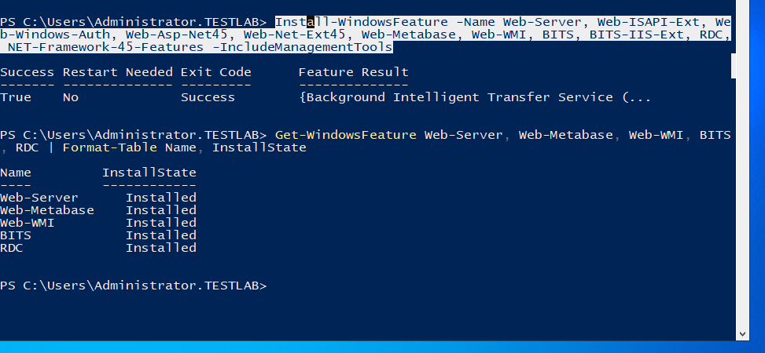
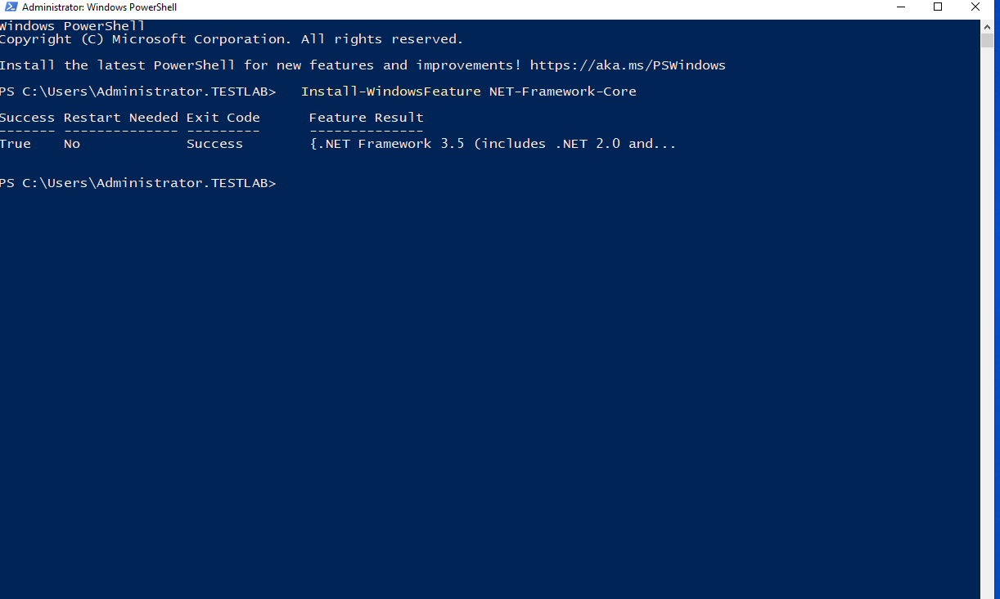
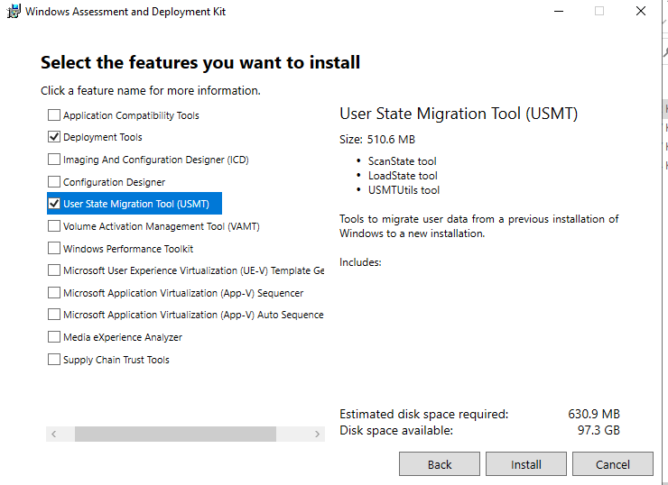
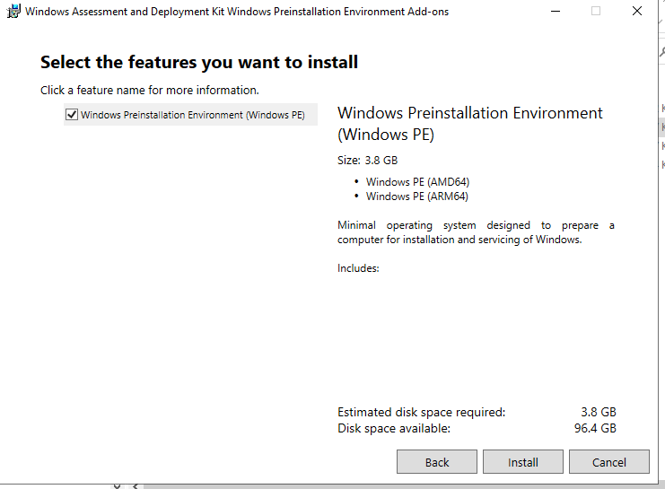
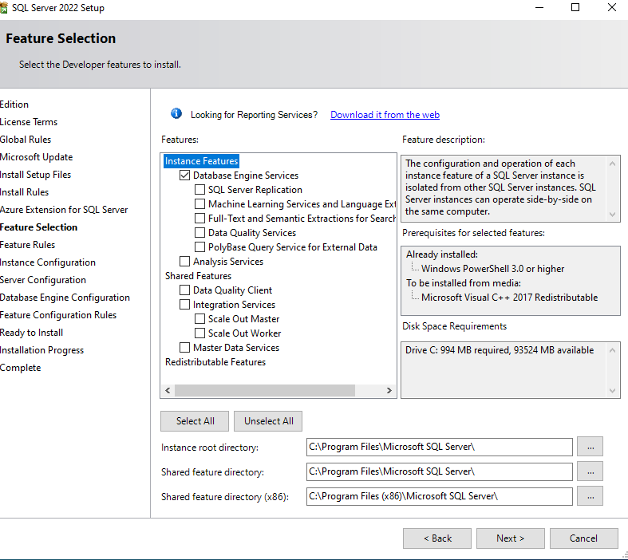
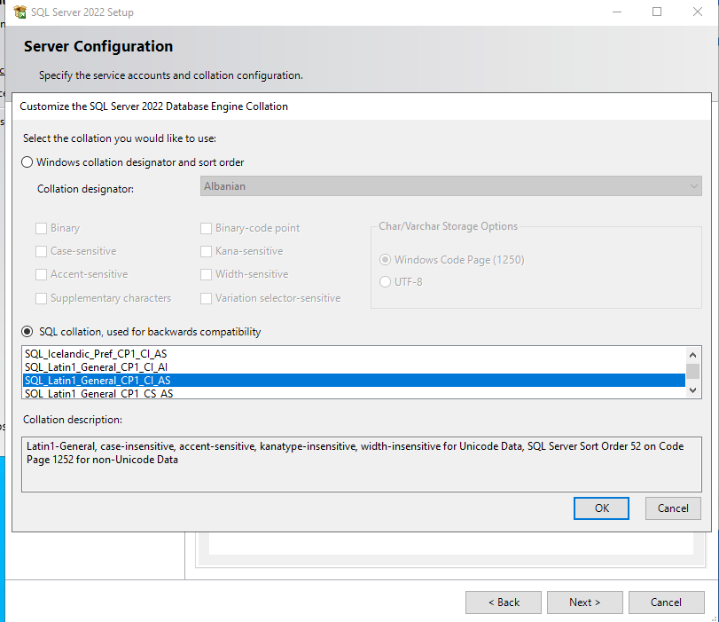
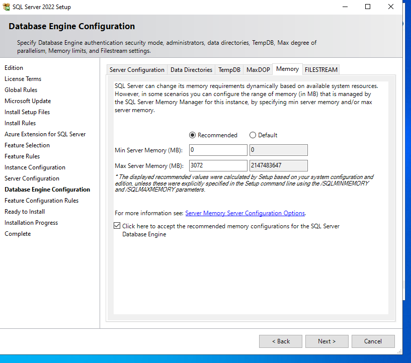
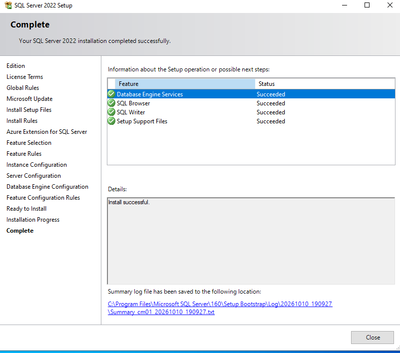
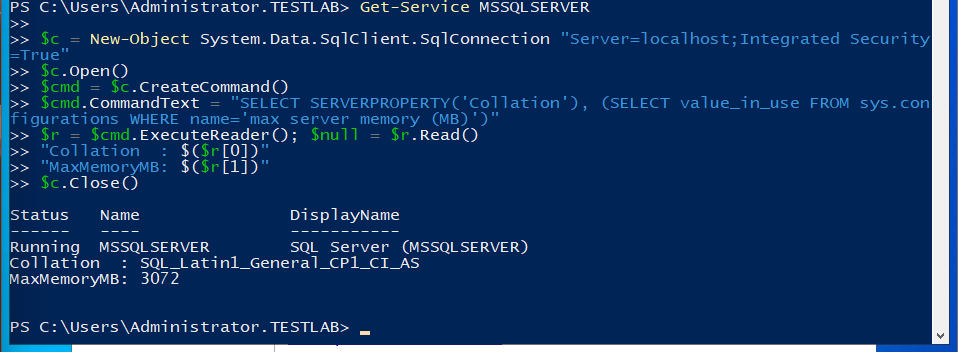

# Chapter 2: Prerequisites and SQL Server

[← Chapter 1](01-preparation-and-ad.md) · [README](../README.md) · [Next: SCCM installation →](03-sccm-installation.md)

**Where we are:** CM01 is in the domain, the AD schema is extended and CM01 can write to System Management.  
**In this chapter:** Install everything SCCM needs before its own setup. This went smoothly, but one test here hid the problem in the next chapter.

---

## IIS, BITS and RDC

MP and DP run on IIS. Clients download content with BITS.

```powershell
Install-WindowsFeature -Name Web-Server, Web-ISAPI-Ext, Web-Windows-Auth, Web-Asp-Net45, Web-Net-Ext45, Web-Metabase, Web-WMI, BITS, BITS-IIS-Ext, RDC, NET-Framework-45-Features -IncludeManagementTools
```



## .NET Framework 3.5

.NET 4.8 does not include 3.5. Some SCCM parts need it.



## Windows ADK and WinPE add-on

Only **Deployment Tools** and **USMT**. SCCM builds its boot image from WinPE during setup, so the ADK must be installed **before** SCCM.





## SQL Server 2022 Developer

| Setting | Value | Why |
| --- | --- | --- |
| Features | Database Engine Services only | SCCM needs nothing else |
| Collation | `SQL_Latin1_General_CP1_CI_AS` | Required by SCCM, very hard to change later |
| Authentication | Windows authentication | SCCM connects with Windows identity |
| Max memory | 3072 MB | Default is unlimited; SCCM services on the same server need RAM too |









✅ **Check:** Collation and memory confirmed with a query:



> **Note:** I ran this test with `Server=localhost`. A local connection uses *shared memory*, not TCP. That is why it worked, and why I missed the next problem.

**Next:** All prerequisites are in place. Time to install SCCM itself.

---

**Microsoft Learn:** [Site prerequisites](https://learn.microsoft.com/en-us/intune/configmgr/core/plan-design/configs/site-and-site-system-prerequisites) · [SQL Server support](https://learn.microsoft.com/en-us/intune/configmgr/core/plan-design/configs/support-for-sql-server-versions) · [Manage boot images](https://learn.microsoft.com/en-us/intune/configmgr/osd/get-started/manage-boot-images)
