# Chapter 3: SCCM Installation

[← Chapter 2](02-prerequisites-and-sql.md) · [README](../README.md) · [Next: DC license →](04-dc-license.md)

**Where we are:** AD is prepared, IIS, .NET, ADK and SQL Server are installed.  
**In this chapter:** Install Configuration Manager 2509 as a stand-alone primary site (`TL1`) with SQL, MP and DP on one server. Three problems on the way: offline prerequisites, failed SQL checks, and the "SQL RMO" error.

---

## Setup wizard

**Typical installation, stand-alone primary site:**

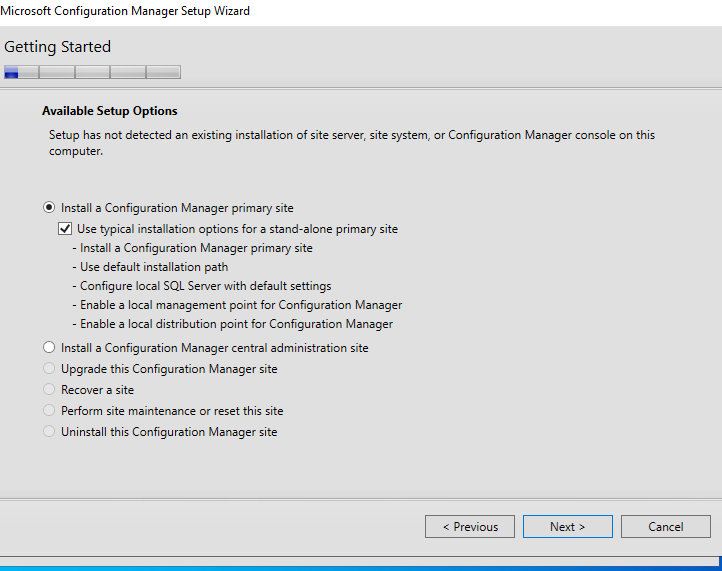

### 🔴 Prerequisite download failed

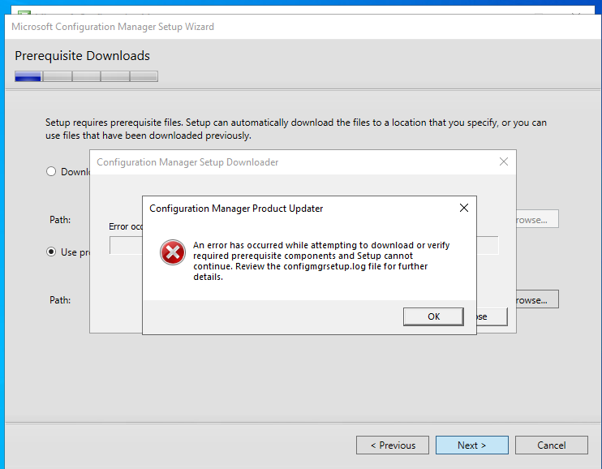

**Cause:** The NAT adapter was off, so CM01 had no internet.
**Fix:** I had already downloaded the files with `setupdl.exe` to `C:\CMPrereqs`. I chose *Use previously downloaded files*.

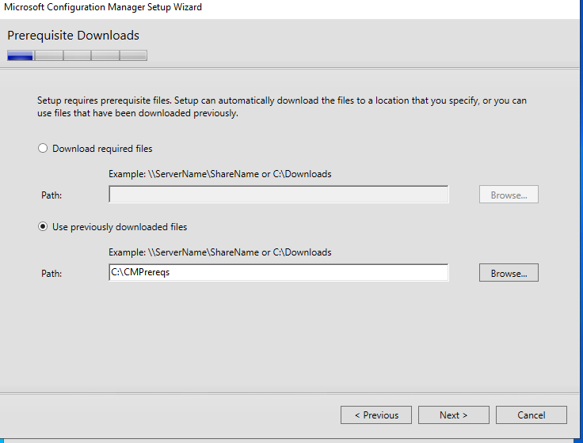

Site code `TL1`, site name `Testlab Primary`:

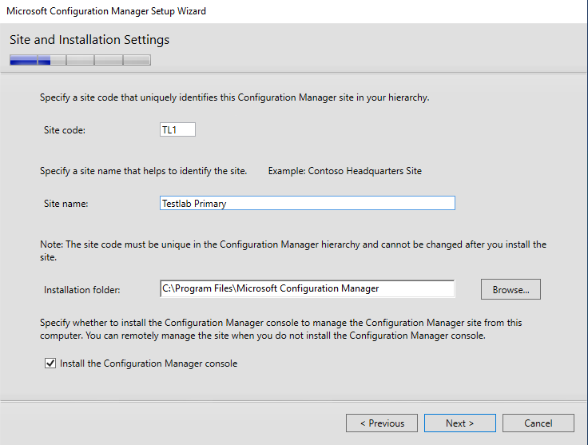

## 🔴 Prerequisite check: Failed

First run: *SQL Server service running account* and *Dedicated SQL Server instance* failed.

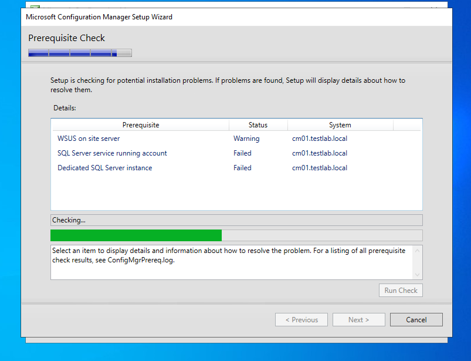

- **Service account:** SQL ran as the default virtual account. I changed it to **Local System** (lab only; production should use a domain account or gMSA). This check passed.

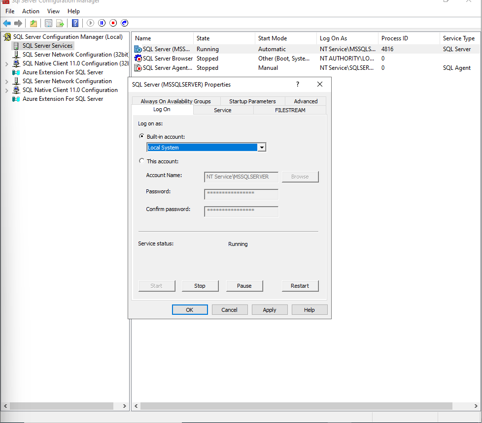

- **Index create memory:** The check wanted the default value (0).

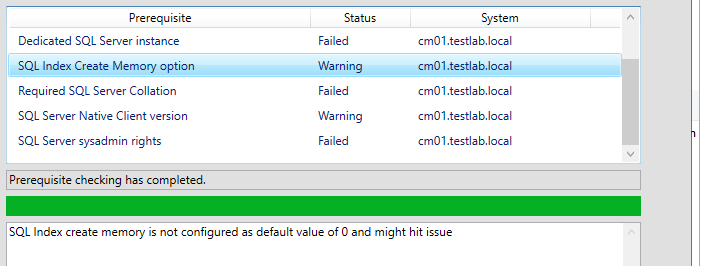

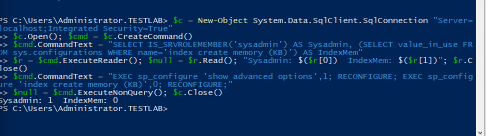

- ODBC Driver 18 version confirmed (18.5.1.1):

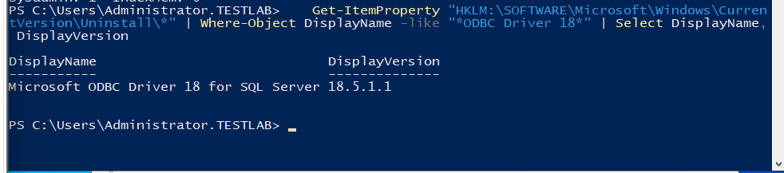

### Still failing

Now *Dedicated SQL Server instance*, *Required SQL Server Collation* and *SQL Server sysadmin rights* all failed.

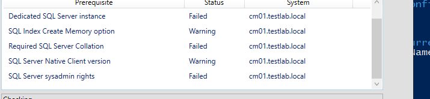

But I knew all three were correct: collation was verified in chapter 2, sysadmin was just confirmed. **Three correct settings failing together means the problem is the connection, not the settings.**

### 🔍 Root cause: TCP/IP disabled

```powershell
Test-NetConnection cm01.testlab.local -Port 1433
```

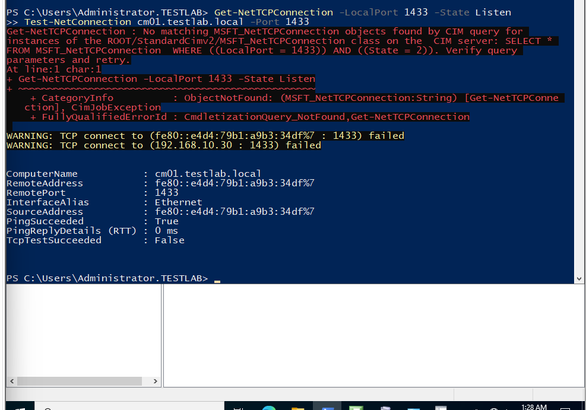

`TcpTestSucceeded : False`. In SQL Server Developer edition, **TCP/IP is disabled by default**. Setup connects to SQL by FQDN over TCP, so it could not verify anything.

**Fix:** SQL Server Configuration Manager → Protocols for MSSQLSERVER → **TCP/IP: Enabled**, then restart the SQL service.

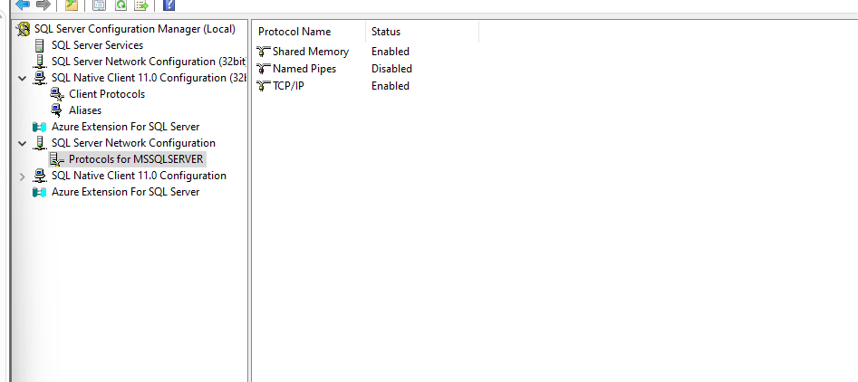

### 🔴 SQL service stopped

After CM01 froze and restarted, SQL stayed **Stopped**:

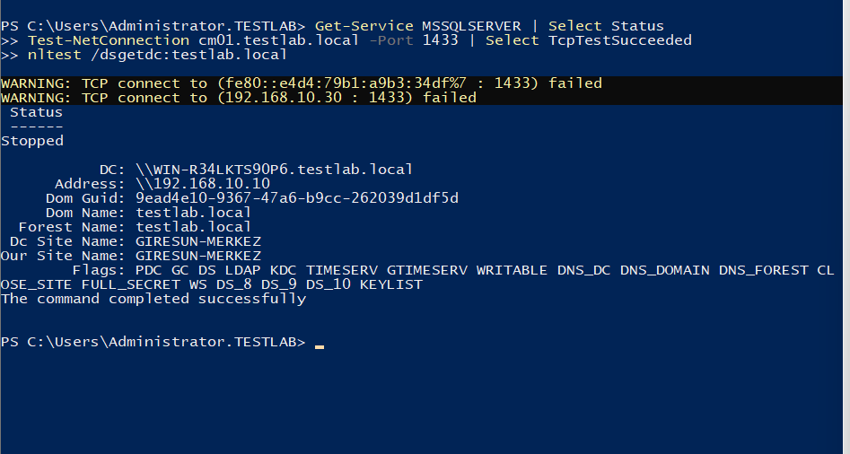

**Fix:** Started the service and set it to **Automatic (Delayed Start)**.

### ✅ Warnings only

No more failures. The remaining warnings do not block setup:

- *WSUS on site server:* software updates are out of scope.
- *SQL Server Native Client:* SCCM 2509 uses ODBC 18.
- *SQL Server security mode:* Windows auth only, confirmed with `IsIntegratedSecurityOnly = 1`.
- *SQL Server process memory:* max memory kept at 3072 MB on purpose.

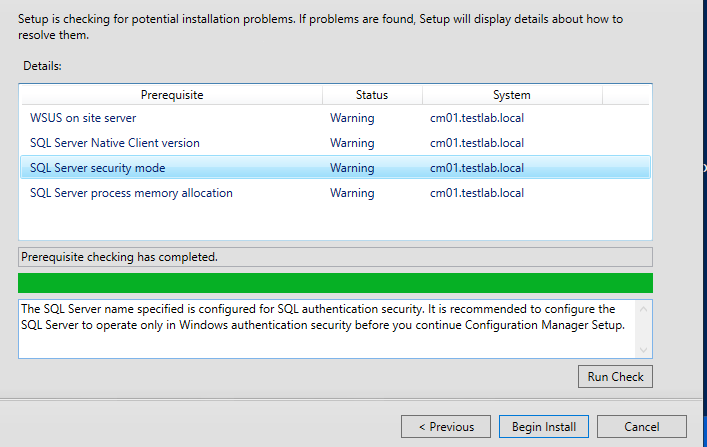

## 🔴 "Setup could not install SQL RMO"

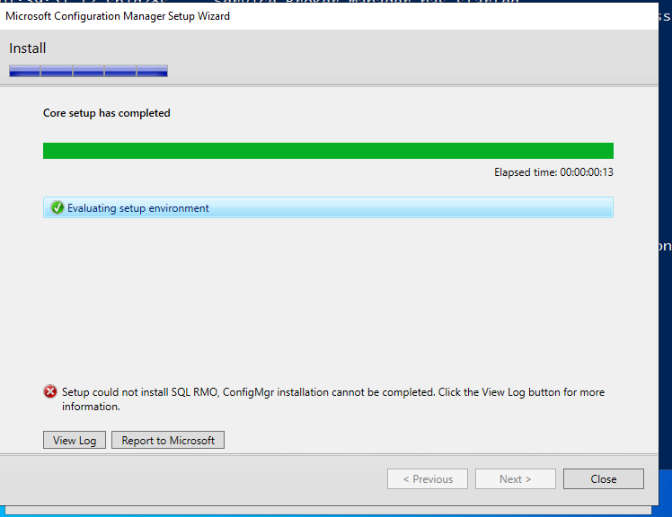

**Investigation:** `ConfigMgrSetup.log` showed the real failure was `msoledbsql.msi` (OLE DB Driver 19). Running it by hand showed the actual message:

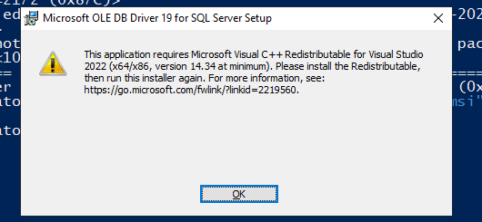

**Root cause:** OLE DB Driver 19 needs Visual C++ 2015–2022 **14.34 or newer**. The server had an older version.

**Fix:** Enabled NAT briefly, installed VC++ x64 and x86, disabled NAT, installed the OLE DB driver.

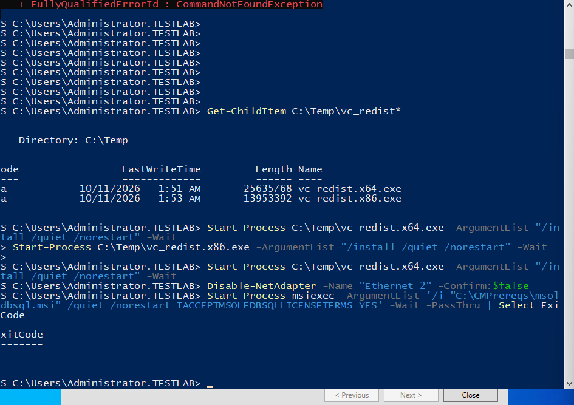

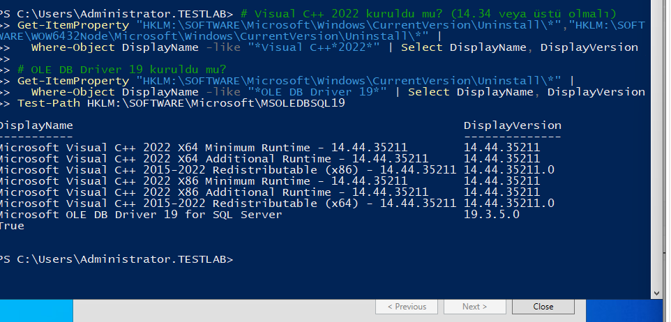

## ✅ Setup complete

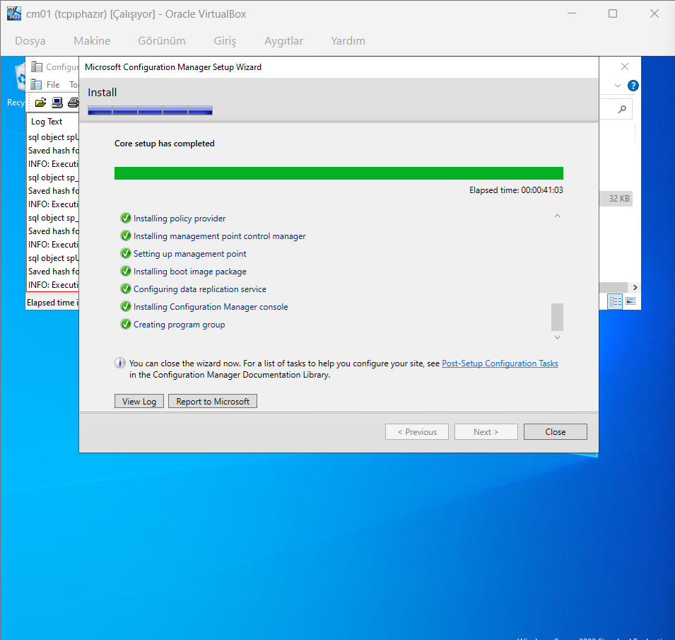

> **Lessons:**
> - When several checks fail at once, look for what they have in common.
> - A test must follow the real path. My localhost test never used TCP.
> - The component in the error message (SQL RMO) may not be the real problem. Follow the log.

**Next:** Setup finished at night. The next morning, the site was not healthy.

---

**Microsoft Learn:** [Prerequisite checker](https://learn.microsoft.com/en-us/intune/configmgr/core/servers/deploy/install/prerequisite-checker) · [Setup Downloader](https://learn.microsoft.com/en-us/intune/configmgr/core/servers/deploy/install/setup-downloader) · [SQL Server support](https://learn.microsoft.com/en-us/intune/configmgr/core/plan-design/configs/support-for-sql-server-versions)
