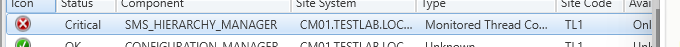
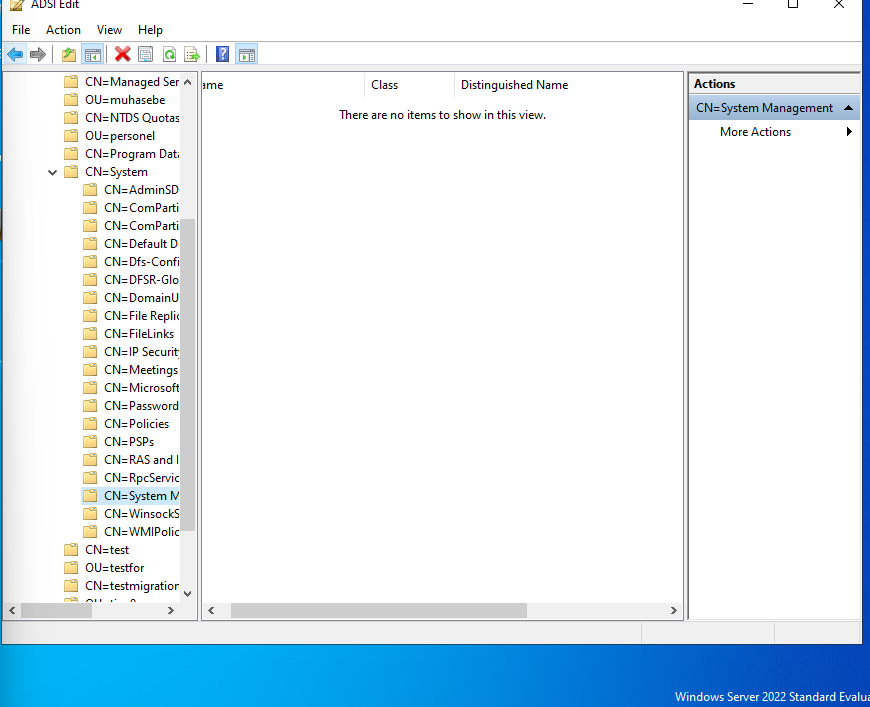
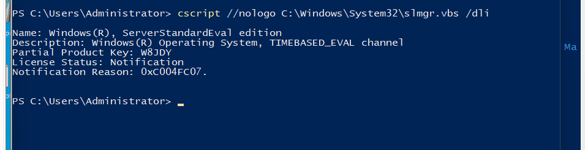
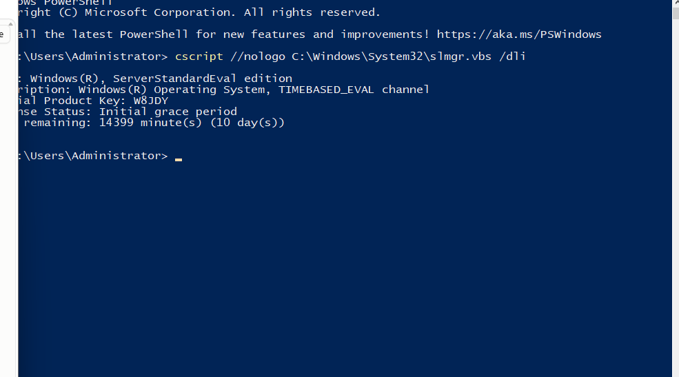
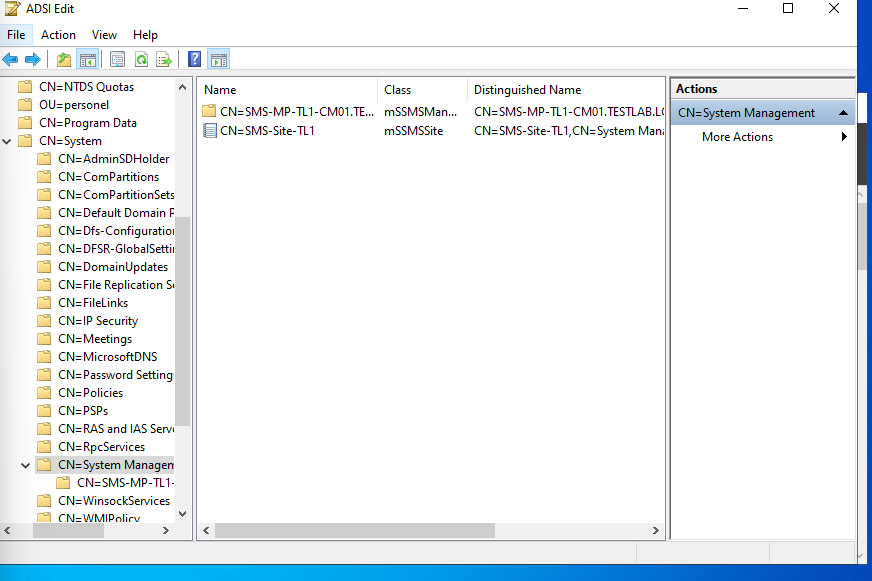
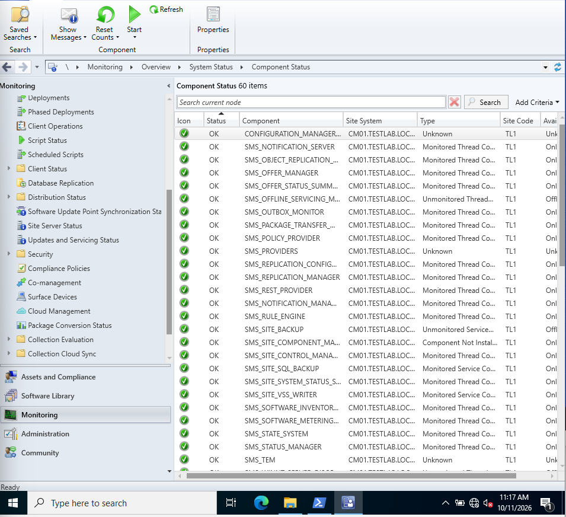

# Chapter 4: Morning Surprise: DC License

[← Chapter 3](03-sccm-installation.md) · [README](../README.md) · [Next: OSD configuration →](05-osd-configuration.md)

**Where we are:** SCCM is installed (site TL1).  
**In this chapter:** A quick health check turns into a hunt: the site is not published to AD, and the cause is on the DC, not on CM01.

---

## 🔴 Hierarchy Manager: Critical

In Monitoring → Component Status, `SMS_HIERARCHY_MANAGER` was red:



Hierarchy Manager publishes the site to AD. The `System Management` container was **empty**:



Permissions were set in chapter 1. The target was ready, so the writer could not write. I looked at the other side: the DC.

## 🔍 Root cause: expired evaluation license

```powershell
cscript //nologo C:\Windows\System32\slmgr.vbs /dli
```



`License Status: Notification`, reason `0xC004FC07`. The Windows Server evaluation had expired. An expired evaluation shuts itself down regularly. The DC was off during the night, so SCCM could not write to AD.

**Fix:**

```powershell
slmgr /rearm          # on DC1, adds a new grace period
Restart-Computer
Restart-Service SMS_EXECUTIVE   # on CM01, so Hierarchy Manager retries
```



## ✅ Site published

`SMS-Site-TL1` and `SMS-MP-TL1-CM01...` appeared in AD:





> **Lesson:** The component showing the error (SCCM) and the source of the problem (DC license) were on different machines. If the error is about publishing or connecting, check the other side too.

**Next:** The site is healthy and visible in AD. Now we prepare the deployment itself.

---

**Microsoft Learn:** [Log files (hman.log)](https://learn.microsoft.com/en-us/intune/configmgr/core/plan-design/hierarchy/log-files) · [Extend the schema](https://learn.microsoft.com/en-us/intune/configmgr/core/plan-design/network/extend-the-active-directory-schema)
