# Chapter 6: First Attempt: PXE-Test

[← Chapter 5](05-osd-configuration.md) · [README](../README.md) · [Next: Second attempt →](07-second-attempt-success.md)

**Where we are:** DHCP, PXE, boot image, OS image, task sequence and deployment are ready.  
**In this chapter:** The first real test on a VM called `PXE-Test`. Two runs failed, but each got further: the first stopped at a full disk, the second hung at the end of Windows setup.

---

## Test VM

`PXE-Test`: BIOS, 2 GB RAM, Intel PRO/1000 MT on `intnet`, network first in boot order.

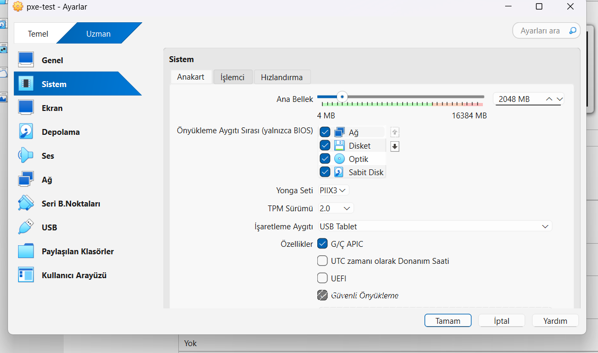

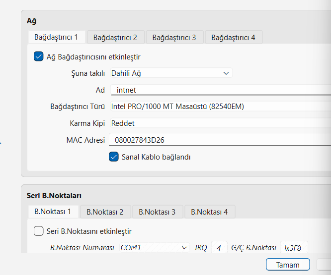

## 🔴 PXE-E52

The first boot stopped before getting a DHCP address:

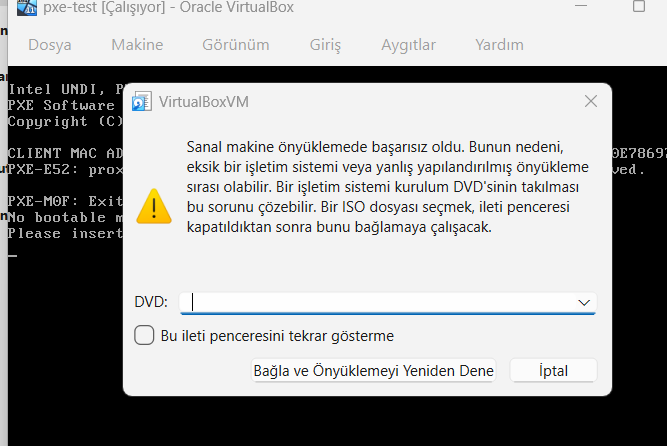

DHCP service, binding and scope were all fine. A reboot fixed it. It was a temporary delay.

## ✅ PXE works

IP 192.168.10.100, CM01 answered and sent `pxeboot.com`, F12 started the network boot:

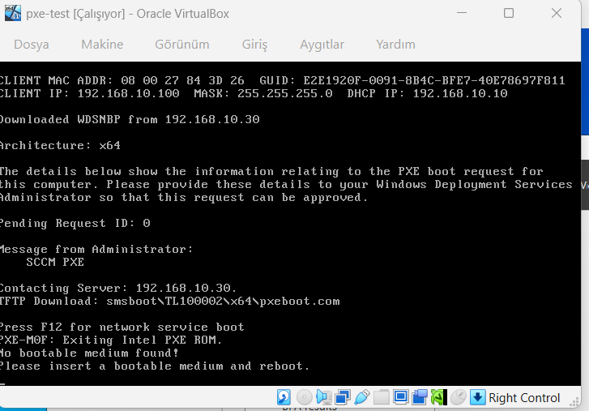

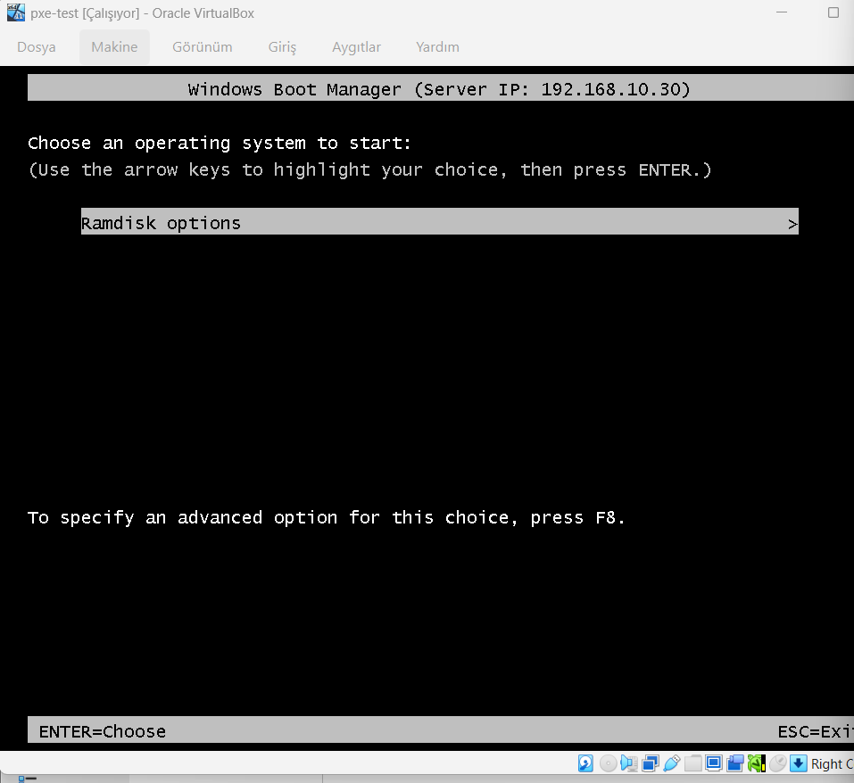

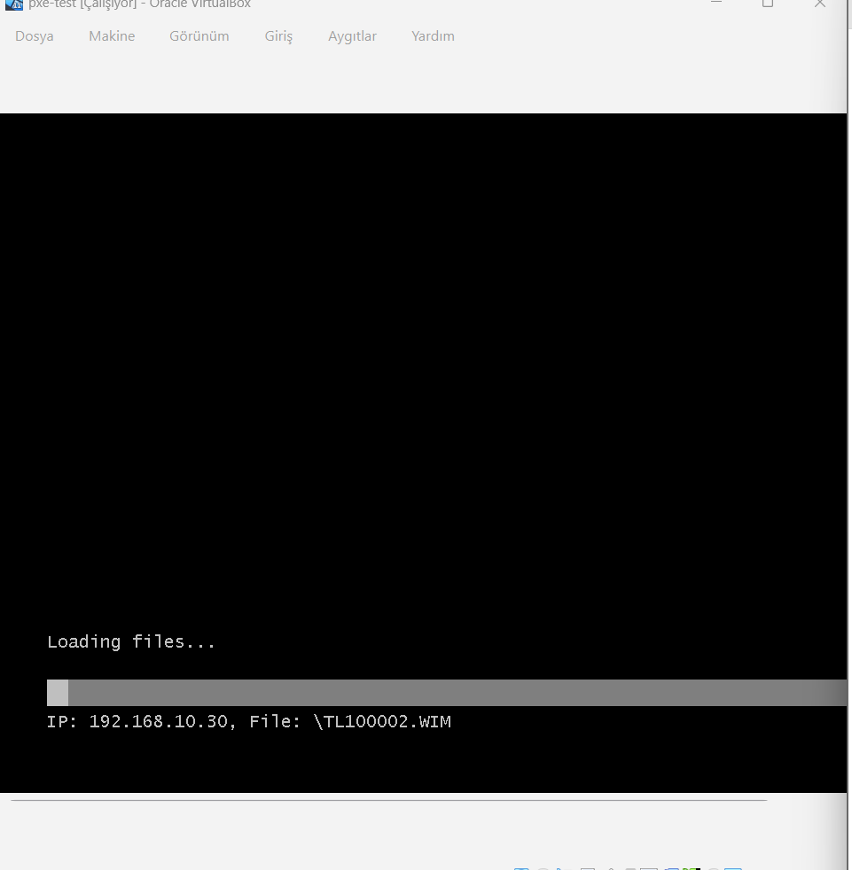

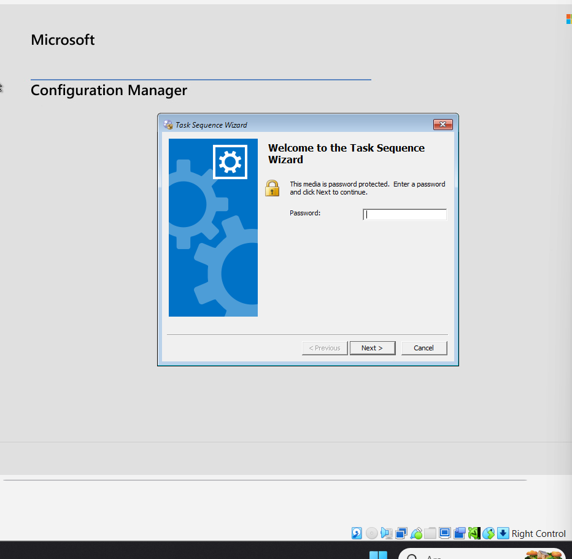

## 🔴 Run 1: 0x80070070

The task sequence failed at *Apply Operating System* with `0x80070070` (not enough disk space). F8 → `diskpart`:

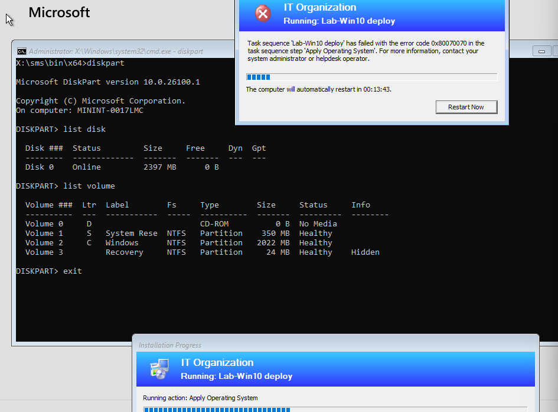

The disk was only **2397 MB**; the 4.4 GB image did not fit.
**Fix:** Resized the VM disk to 60 GB.

## 🔴 Run 2: stuck at "Getting ready"

All task sequence steps finished:

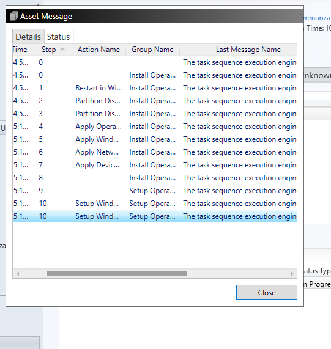

Then Windows stayed on "Getting ready" for a long time. VirtualBox showed **VMM load 92%**, guest load 7%: almost all CPU time went to the virtualization layer, not the VM.

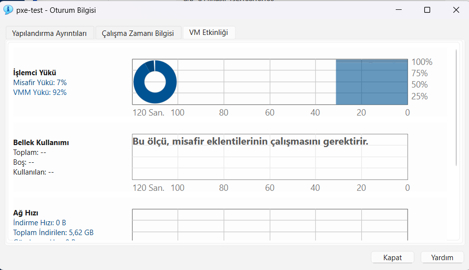

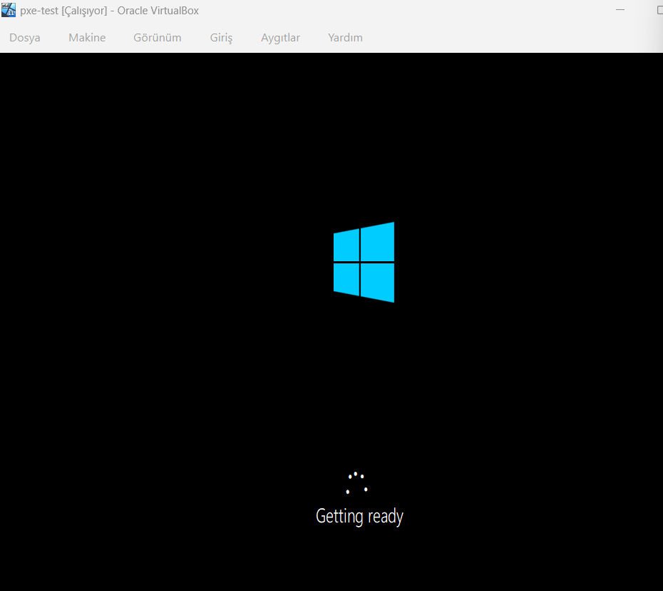

I forced a reset. That was a mistake: the install was in the middle of Windows setup and could not recover.

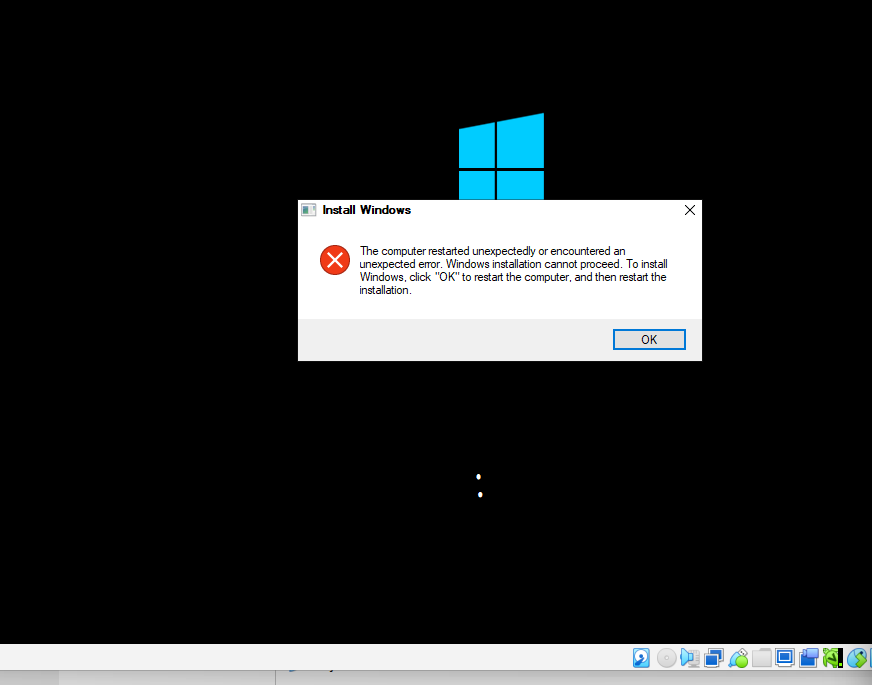

## Decision: start over

The broken install left an **Unknown** device record in SCCM. With a record, the machine is no longer "unknown" and no longer sees the deployment. I deleted the record and planned a fresh VM.

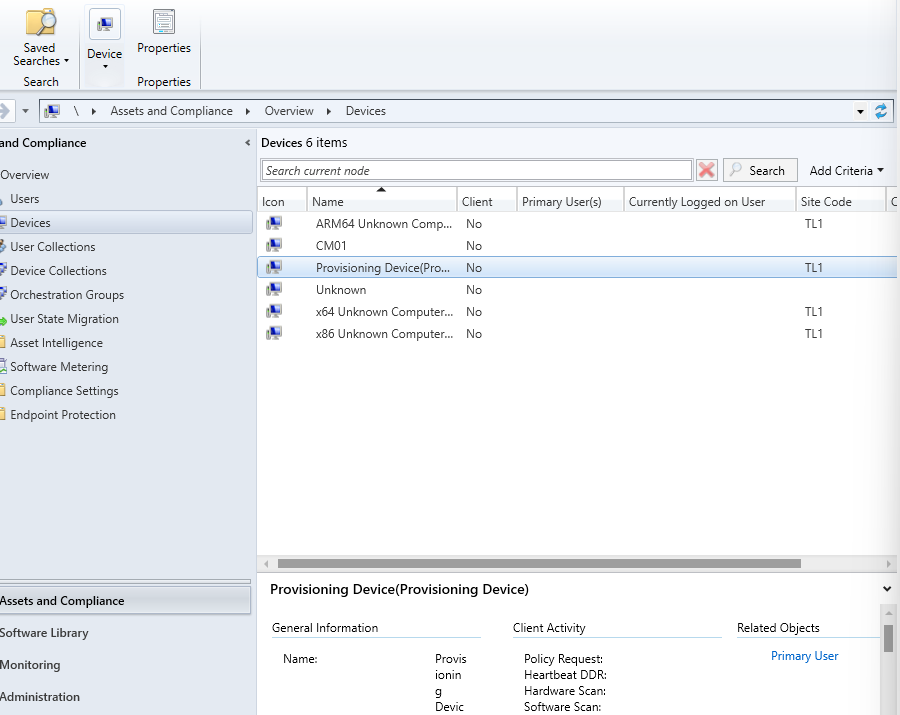

> **Lessons:**
> - Look up the error code (0x80070070 = disk full), then verify it (diskpart).
> - A forced reset in the middle of setup turns a hang into a broken install.
> - VMM 92% was a clue that the problem was in the virtualization layer. I solved it the next day.

**Next:** A fresh VM, and the real cause of the slowness.

---

**Microsoft Learn:** [Use PXE](https://learn.microsoft.com/en-us/intune/configmgr/osd/deploy-use/use-pxe-to-deploy-windows-over-the-network) · [Unknown computers](https://learn.microsoft.com/en-us/intune/configmgr/osd/get-started/prepare-for-unknown-computer-deployments) · [Monitor OS deployments](https://learn.microsoft.com/en-us/intune/configmgr/osd/deploy-use/monitor-operating-system-deployments)
