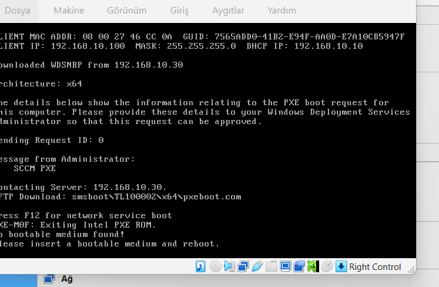
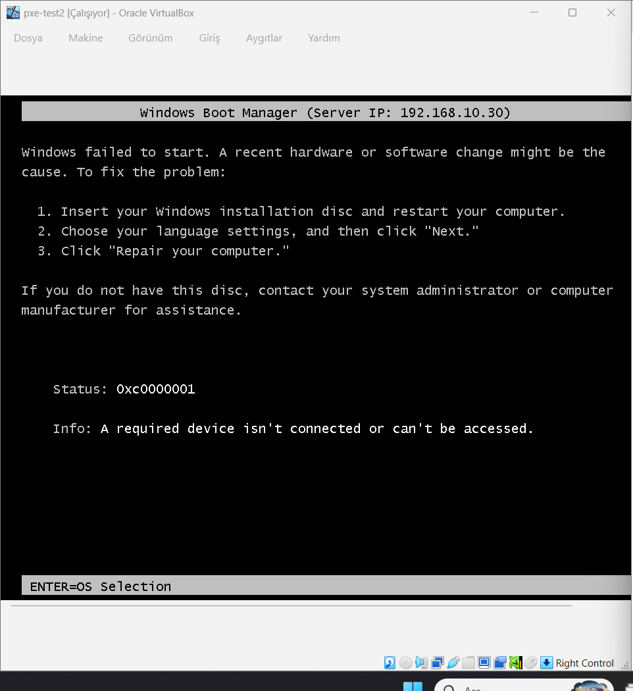
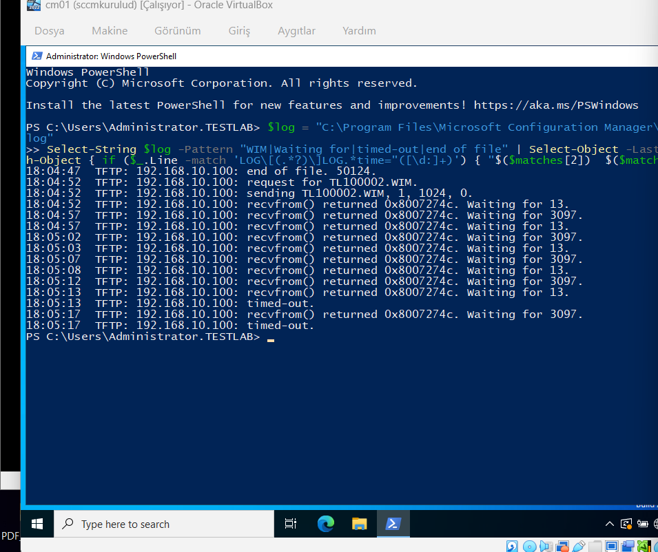
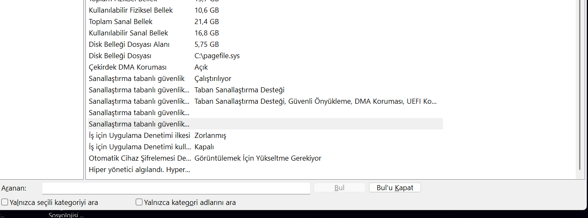
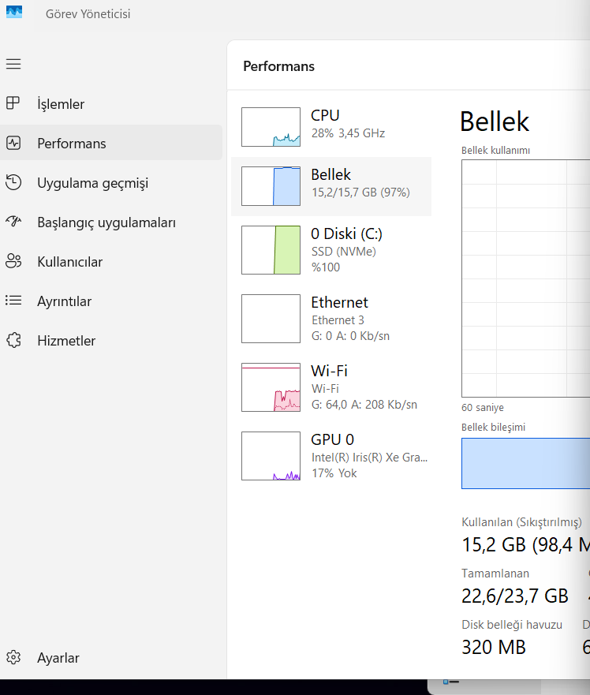
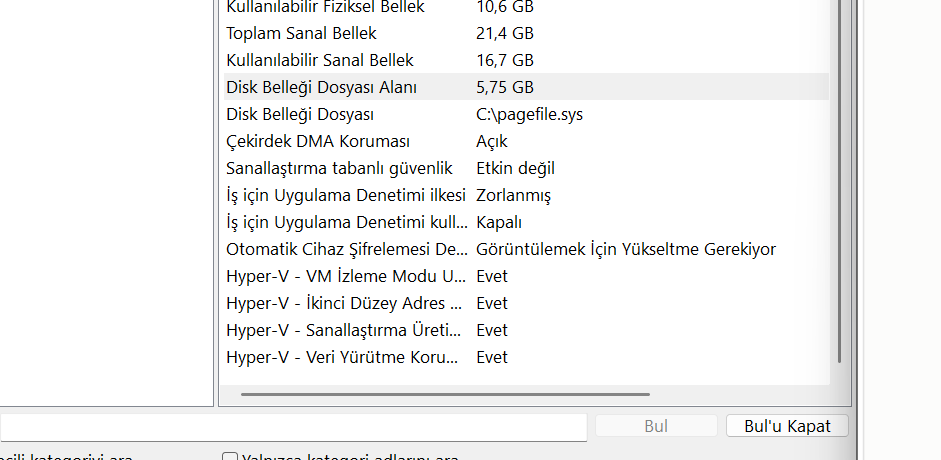
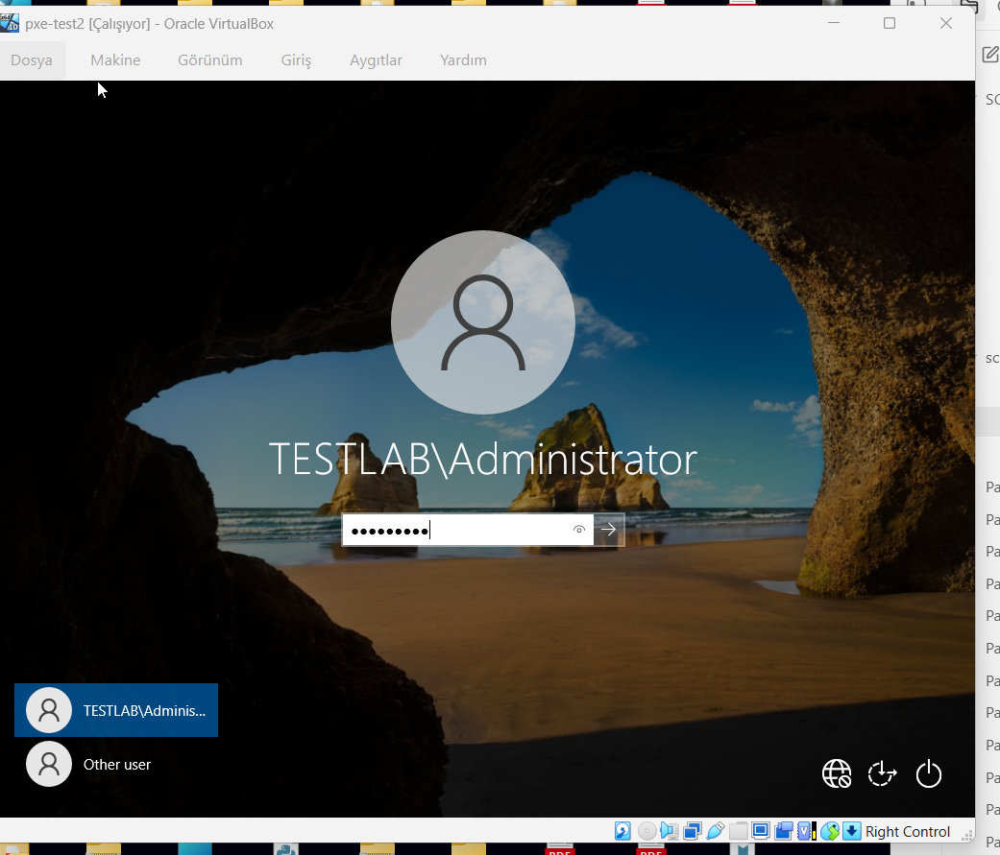

# Chapter 7: Second Attempt and Success

[← Chapter 6](06-first-attempt.md) · [README](../README.md)

**Where we are:** The first VM was lost. The SCCM side is working; the host seems slow.  
**In this chapter:** A fresh VM (`PXE-Test2`), a new error at the boot image stage, its real cause on the host, and the successful deployment.

---

## New VM

`PXE-Test2`: BIOS, **60 GB** disk, 2 GB RAM, new MAC (`08:00:27:46:CC:0A`). PXE worked right away:



## 🔴 0xc0000001: "A required device isn't connected"

Boot Manager stopped while loading the boot image:



The boot image (`boot.wim`) did not fully arrive over TFTP. On CM01:

```powershell
$log = "C:\Program Files\Microsoft Configuration Manager\Logs\SMSPXE.log"
Select-String $log -Pattern "WIM|Waiting for|timed-out|end of file" | Select-Object -Last 30
```



The server sends blocks, but the client does not acknowledge in time: `recvfrom() returned 0x8007274c`, then `timed-out`, at a different point each time.

### First guess: TFTP settings (wrong)

Microsoft Learn says large TFTP block sizes can cause timeouts. I set `RamDiskTFTPBlockSize` to 1024. **It got worse**, so I reverted it.

That told me the problem was not the packet size. Two VMs on the same virtual network should not lose packets; the answers were just too slow. With the VMM 92% from chapter 6, the real suspect was **performance of the VMs, not the network**.

### 🔍 Root cause: VirtualBox running on top of Hyper-V

`msinfo32` on the host:



*Virtualization-based security: Running* and *A hypervisor has been detected*. On Windows 11, VBS (Memory Integrity, Credential Guard) runs Hyper-V in the background. Hyper-V takes the CPU's virtualization feature (VT-x), so VirtualBox has to run on top of it in a much slower mode (**Native API**). TFTP's strict timeouts could not handle that.

Host memory was also at 97% (15.2 / 15.7 GB):



**Fix:**

1. In an elevated prompt, then reboot:
   ```cmd
   bcdedit /set hypervisorlaunchtype off
   ```
2. Lowered VM memory: DC1 2 GB, CM01 4–5 GB (SQL max memory temporarily 2048 MB). Closed other apps.

✅ After reboot: VBS **not enabled**, Hyper-V requirements show "Yes" (VT-x is free for VirtualBox):



## ✅ Success

The boot image loaded, WinPE started, and the task sequence ran end to end. (I did not take a screenshot of the steps on this run; they are the same as in [chapter 6](06-first-attempt.md).) The login screen showed a domain account:



```powershell
whoami                                         # testlab\administrator
hostname                                       # MININT-NBUA0IE
(Get-CimInstance Win32_ComputerSystem).Domain  # testlab.local
Get-Service CcmExec | Select Status            # Running
```


| Step | Result |
| --- | --- |
| IP from DHCP | ✅ 192.168.10.100 |
| PXE answer from CM01 | ✅ |
| Boot image over TFTP | ✅ |
| WinPE + task sequence | ✅ |
| Windows 10 Pro installed | ✅ |
| Domain join | ✅ testlab.local |
| SCCM client | ✅ CcmExec running |

The computer name stayed as the automatic `MININT-...` because the task sequence did not set one. Next step: `OSDComputerName`.

> **Lessons:**
> - A symptom in the log (timeouts) does not always mean that setting is wrong. If changing it makes things worse, look at another layer.
> - The lab host is part of the system. A host security feature (VBS) broke a network protocol inside the VMs.
> - Turn it back on after the lab: `bcdedit /set hypervisorlaunchtype auto`.

## Lab cleanup

- [ ] Set SQL max memory back to 3072 MB
- [ ] `bcdedit /set hypervisorlaunchtype auto` + reboot
- [ ] Detach the WDS disk from CM01 (checked: `SCCMContentLib` and `Sources` are on C:)
- [ ] Snapshot CM01: `OSD-Success`

---

**Microsoft Learn:** [TFTP block and window size](https://learn.microsoft.com/en-us/intune/configmgr/osd/get-started/prepare-site-system-roles-for-operating-system-deployments#customize-the-ramdisk-tftp-block-and-window-sizes-on-pxe-enabled-distribution-points) · [Log files (SMSPXE.log)](https://learn.microsoft.com/en-us/intune/configmgr/core/plan-design/hierarchy/log-files#os-deployment) · [Troubleshoot PXE](https://learn.microsoft.com/en-us/troubleshoot/mem/configmgr/os-deployment/troubleshoot-pxe-boot-issues) · [Task sequence variables](https://learn.microsoft.com/en-us/intune/configmgr/osd/understand/task-sequence-variables)
